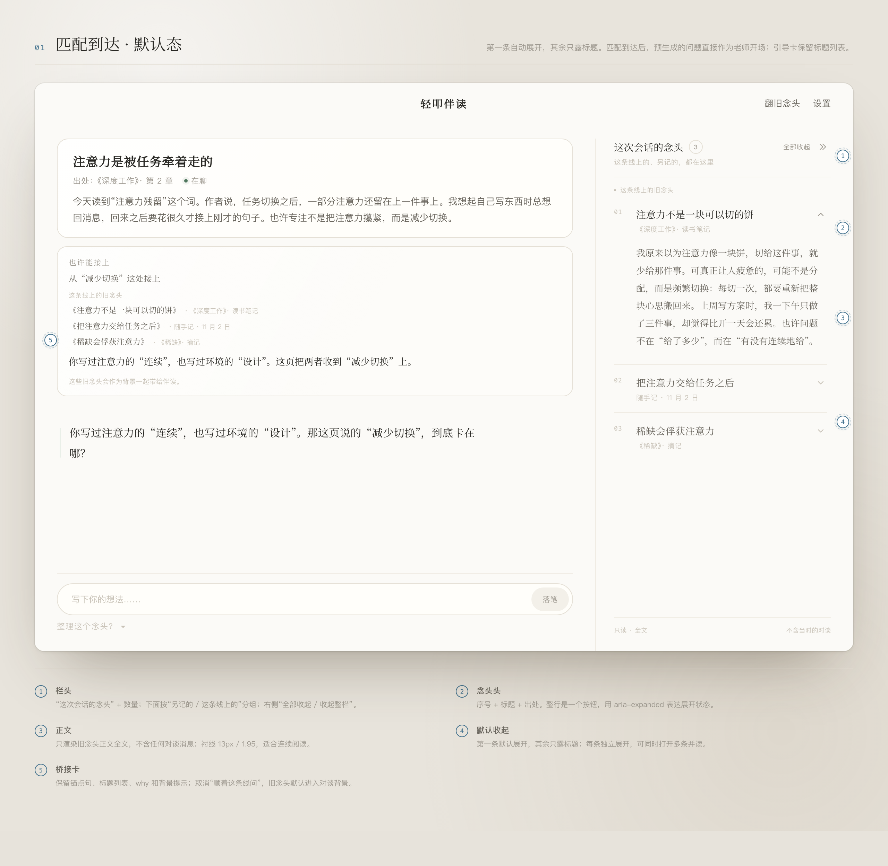
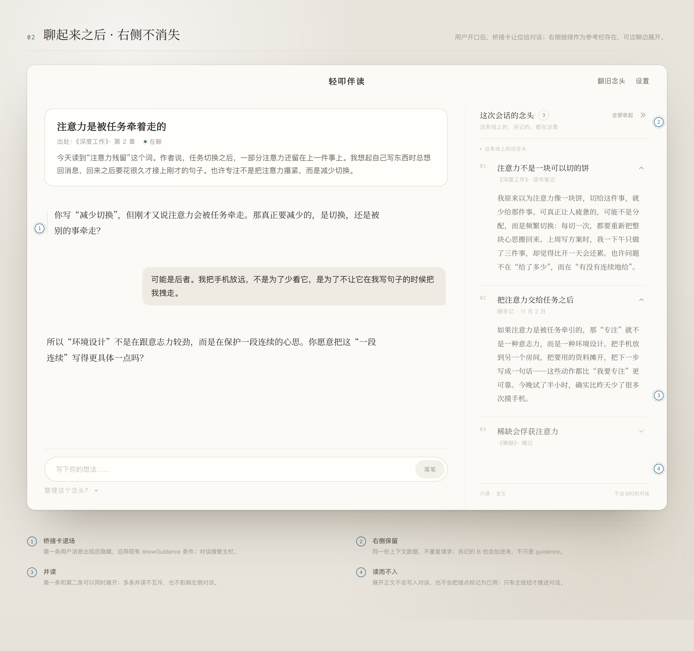
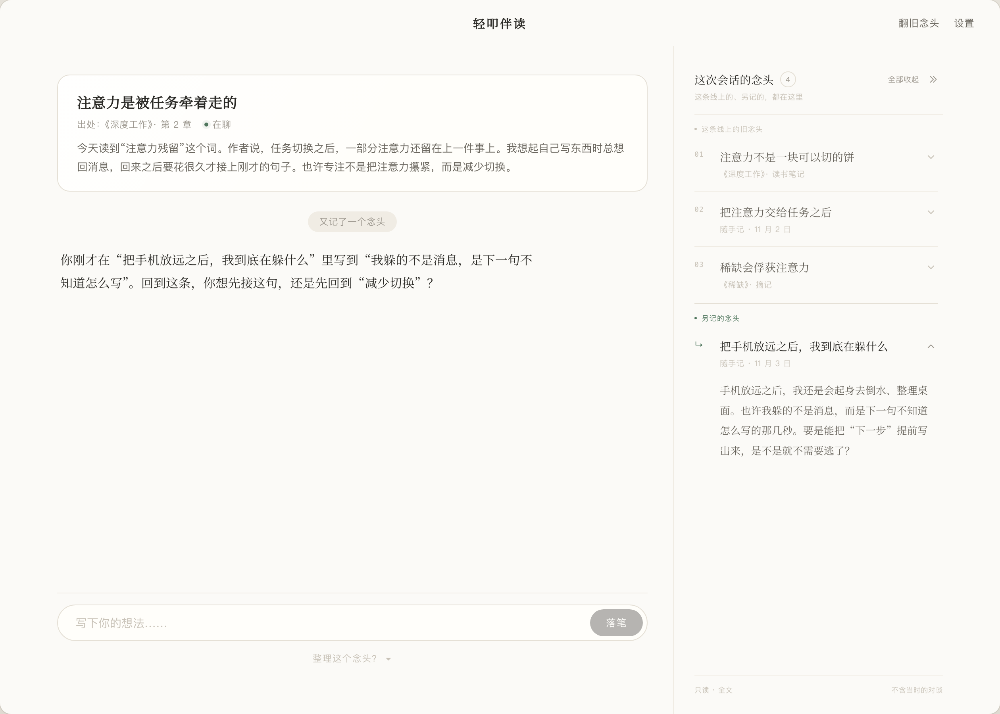
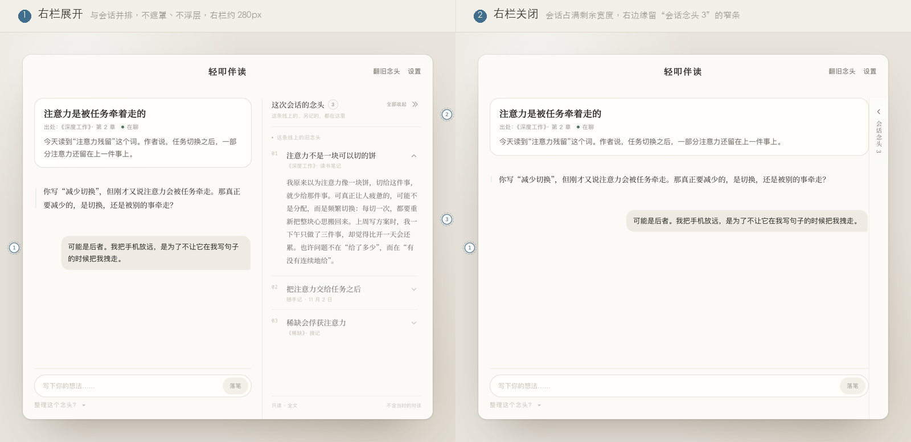

# TapAlong · 轻叩伴读

**English** | [简体中文](README.zh-CN.md)

> A local-first reading companion that asks questions instead of writing for you.

TapAlong is a small desktop app for thinking alongside your reading. You jot down a
thought; it asks one good question at a time, connects that thought with things
you wrote earlier, and leaves the thinking to you. It never drafts your notes,
never puts words in your mouth, and keeps your notes on your own machine.

- **Questions, not answers.** The companion's job is to help you find the next
  sentence yourself.
- **Local-first notes.** Thoughts, conversations, and pasted images live in a
  local SQLite database and a local image folder. No account, no sync.
- **Context you can see.** A side rail shows the earlier thoughts that a question
  is drawing on, so the connection is never a black box.

> **Status: experimental alpha (v0.1.0).** macOS 13+ on Apple silicon only.
> There is no signed installer yet. Expect rough edges and breaking changes.
> See [Project status](#project-status).

## Screenshots

These are interface wireframes from [`wireframes/`](wireframes/), not screenshots
of a shipped build.

### Default state: the current thought, the bridge, and the rail



The current thought stays on the left. A bridge card shows which earlier thoughts
it connects to, and the session-thoughts rail keeps the whole thread in view.

### After the conversation starts



When you reply, the bridge card steps aside. The rail stays as a reference you can
read alongside the conversation instead of losing the context.

### The session-thoughts rail, as implemented



Earlier thoughts stay readable while the companion asks its next question.

### Narrow windows



The rail can sit beside the conversation or collapse into a slim edge tab.

## Requirements

- macOS 13 or newer, **Apple silicon (arm64)**. Intel Macs and Windows/Linux are
  not supported yet.
- [Node.js](https://nodejs.org/) **24 or newer** (`engines.node` is `>=24`).
- [pnpm](https://pnpm.io/) **11.7.0**, the version pinned in `packageManager`.
  With Corepack: `corepack enable`.

## Run from source

```bash
git clone https://github.com/longtengsongislong520/tap-along.git
cd tap-along
pnpm install
pnpm start
```

`pnpm start` launches the Electron app through Electron Forge. The app runs
against your local data directory; see [Privacy and data](#privacy-and-data).

Useful checks:

```bash
pnpm lint        # oxlint + oxfmt --check
pnpm typecheck   # tsc --noEmit
pnpm test        # main-process tests with node:test
pnpm test:ui     # Vue component tests with Vitest
```

Electron Forge packaging scripts (`pnpm package`, `pnpm make`) exist, but a
complete signed/notarized build guide is still to be written. Do not expect
`pnpm make` to produce a distributable macOS build out of the box yet.

## First-run setup

On first launch TapAlong asks you to either configure a model or try the demo:

1. **Model** — “Configure a model” uses the default **DeepSeek** provider
   (`deepseek-chat`, `https://api.deepseek.com`) or a **Custom** OpenAI-compatible
   endpoint with your own base URL and model ID. Enter the API key in
   Settings → Model and use “Test connection”.
2. **Demo mode** — “Enter demo mode” uses fixed demo lines and is clearly
   labelled. It is for looking around, not for real work.
3. **Web search (optional)** — research is on by default and reuses your DeepSeek
   key through the DeepSeek Search API, which is billed per request. You can turn
   DeepSeek search off in Settings → Search and use a **Tavily** API key instead.

Your notes are sent to the model provider you configure whenever the companion
generates a question or reply. Web search only sends the search query.

## Privacy and data

- **Everything is local by default.** Notes, conversations, guidance, and images
  are stored on this Mac. There is no account, no cloud sync, and no telemetry,
  analytics, or crash reporting.
- **Where the data lives.** TapAlong uses Electron's `userData` directory
  (typically `~/Library/Application Support/TapAlong/`):
  `tap-along.db` (SQLite), `images/` (pasted images), and
  `tap-along-settings.json` (provider and search settings).
- **API keys.** Keys are encrypted with Electron `safeStorage` (backed by the
  macOS Keychain) before being written to the settings file.
- **What is not encrypted.** The SQLite database and image files are plain local
  files. Anyone with access to your macOS account can read them.
- **What leaves the device.** Note text, conversation history, and the related
  thoughts included as context are sent to your model provider when you ask for a
  question or reply. Search queries go to DeepSeek or Tavily when research is
  used. The provider's own privacy policy applies to that data.
- **Deleting data.** Settings → Data & privacy can export or clear local data.
  You can also quit the app and delete the `userData` folder.

See [PRIVACY.md](PRIVACY.md) for the full statement.

## Project status

TapAlong is an **experimental alpha** at **v0.1.0**.

- Only macOS 13+ on Apple silicon is supported.
- **No signed or notarized installer is published yet.** Building from source is
  the only supported way to run it today; packaging and notarization
  instructions are still to be written.
- The data model, prompts, and UI may change without migration guarantees.
- Windows and Linux have not been tested.

## Roadmap

This is a placeholder, not a promise or a schedule:

- A signed and notarized macOS build with a short, honest install guide.
- A packaged-app QA checklist and release automation.
- An accessibility pass (keyboard paths, focus, contrast, reduced motion).
- Longer-conversation context budgeting and better local retrieval.
- An evaluation of Windows/Linux support.

## Feedback and contributing

- **Bugs and concrete requests:** open a [GitHub Issue](https://github.com/longtengsongislong520/tap-along/issues/new/choose).
- **Questions, ideas, and open-ended discussion:** use
  [GitHub Discussions](https://github.com/longtengsongislong520/tap-along/discussions).
- **Security reports:** please do **not** open a public issue. Follow
  [SECURITY.md](SECURITY.md).
- **Contributing:** read [CONTRIBUTING.md](CONTRIBUTING.md). This project follows
  the [Contributor Covenant 2.1](CODE_OF_CONDUCT.md).

## Documentation

The full index is [docs/README.md](docs/README.md).

- [Design notes](docs/design/) — interaction design, architecture, prompt
  engineering, localization, and other design documents (mostly Chinese).
- [Internal notes](docs/internal/) — historical plans, release reviews, and
  checklists. These are working documents and may be out of date.

## License

[MIT](LICENSE) © 2026 TapAlong contributors.
