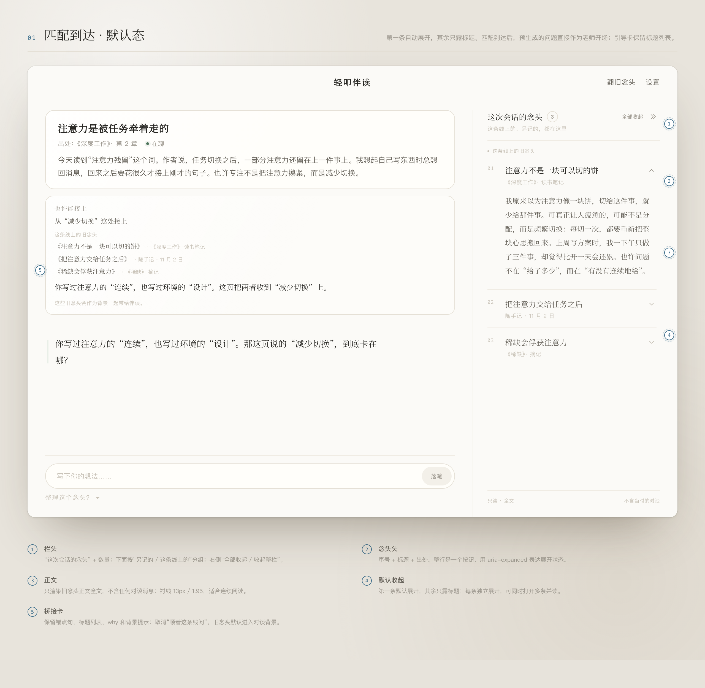
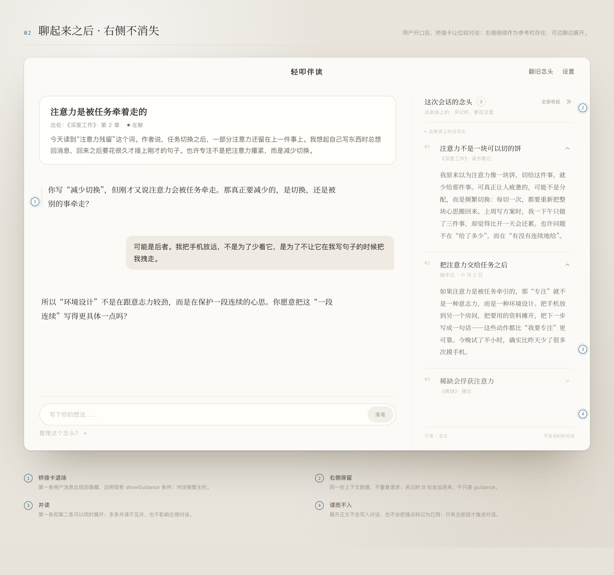
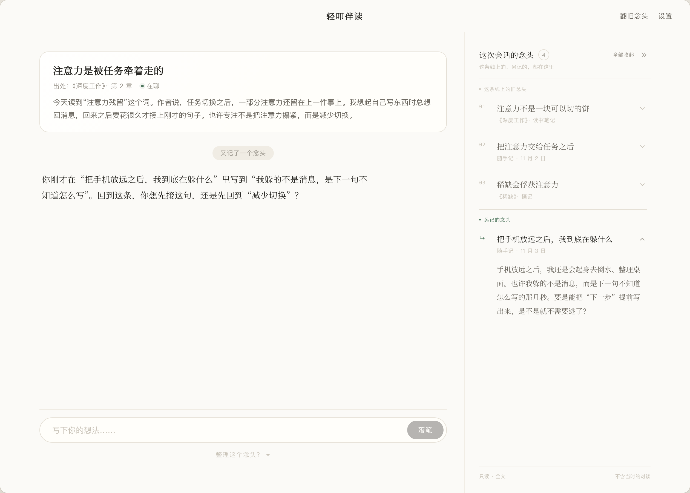
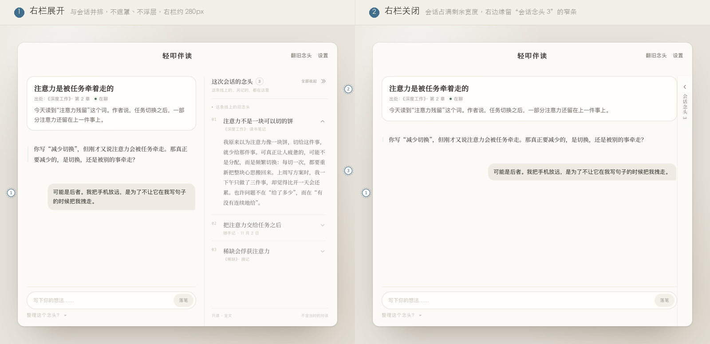

# 轻叩伴读 · TapAlong

[English](README.md) | **简体中文**

> 本地优先的阅读伴读：用提问帮你把想法想明白，而不是替你写。

轻叩伴读是一个陪你在阅读时思考的小型桌面应用。你记下一个念头，它一次只问
一个好问题，并把这条念头和你以前写过的东西接起来，剩下的推理留给你自己。
它不代写笔记，不替你把话说完，笔记也只放在你自己的电脑上。

- **只提问，不代答。** 伴读的职责是帮你找到下一句，而不是替你写出下一句。
- **笔记本地优先。** 念头、对谈和粘贴的图片都保存在本机 SQLite 数据库和本地
  图片目录里。没有账号，也不做同步。
- **上下文看得见。** 右侧栏会列出当前问题参考了哪些旧念头，不用猜它是怎么接上
  的。

> **状态：实验性 alpha（v0.1.0）。** 仅支持 Apple 芯片上的 macOS 13+。
> 暂不提供已签名安装包，会有粗糙之处和破坏性变更。
> 详见[项目状态](#项目状态)。

## 截图

以下界面图来自 [`wireframes/`](wireframes/)，是设计稿，不是正式版本的运行截图。

### 默认状态：当前念头、桥接卡与右侧栏



当前念头留在左侧；桥接卡显示它和哪些旧念头有关；右侧的「这次会话的念头」
让整条线索始终可见。

### 聊起来之后



你回复之后，桥接卡退场，右侧栏继续作为参考存在，不会把上下文弄丢。

### 已实现的会话念头栏



伴读问下一个问题时，之前的念头仍然可以并排阅读。

### 窄窗口



窗口变窄时，右侧栏可以并排展开，也可以收成右边的一条窄边签。

## 环境要求

- macOS 13 或更新版本，**Apple 芯片（arm64）**。暂不支持 Intel Mac、Windows
  和 Linux。
- [Node.js](https://nodejs.org/) **24 或更新版本**（`engines.node` 为 `>=24`）。
- [pnpm](https://pnpm.io/) **11.7.0**，即 `packageManager` 中固定的版本。
  使用 Corepack 时可执行 `corepack enable`。

## 从源码运行

```bash
git clone https://github.com/longtengsong/tap-along.git
cd tap-along
pnpm install
pnpm start
```

`pnpm start` 通过 Electron Forge 启动 Electron 应用。应用会读写本机的数据目录，
见[隐私与数据](#隐私与数据)。

常用检查命令：

```bash
pnpm lint        # oxlint + oxfmt --check
pnpm typecheck   # tsc --noEmit
pnpm test        # 主进程测试（node:test）
pnpm test:ui     # Vue 组件测试（Vitest）
```

仓库里已有 Electron Forge 打包脚本（`pnpm package`、`pnpm make`），但完整的
签名 / 公证构建说明尚未补齐。现阶段不要指望 `pnpm make` 直接产出可分发、
已签名的 macOS 安装包。

## 首次配置

首次启动时，应用会让你二选一：配置模型，或先看演示。

1. **模型** — “配置模型”时默认使用 **DeepSeek**（`deepseek-chat`，
   `https://api.deepseek.com`），也可以在 **Custom** 中填入自己的 OpenAI 兼容
   base URL 与模型 ID。API Key 在「设置 → 模型」中填写，可用“测试连接”验证。
2. **演示模式** — “进入演示模式”使用固定的演示话术，界面上有明确标识。它只适合
   熟悉界面，不适合真实使用。
3. **联网搜索（可选）** — 默认开启，复用你保存的 DeepSeek Key 调用 DeepSeek
   Search API，按次计费。也可以在「设置 → 搜索」里关闭 DeepSeek 搜索，改用
   **Tavily** 的 API Key。

伴读生成问题或回复时，笔记内容会发送给你配置的模型供应商。联网搜索只发送
搜索关键词。

## 隐私与数据

- **默认全部在本地。** 念头、对谈、引导和图片都保存在这台 Mac 上。没有账号，
  没有云同步，也没有遥测、埋点或崩溃上报。
- **数据位置。** 使用 Electron 的 `userData` 目录（通常为
  `~/Library/Application Support/TapAlong/`）：`tap-along.db`（SQLite）、
  `images/`（粘贴的图片）、`tap-along-settings.json`（模型与搜索设置）。
- **API Key。** 写入设置文件前，会先用 Electron `safeStorage`（由 macOS
  钥匙串提供支持）加密。
- **没有加密的部分。** SQLite 数据库和图片是普通的本地文件。能登录你的
  macOS 账户的人就能读到它们。
- **什么会离开本机。** 你请求问题或回复时，笔记正文、对谈历史以及作为上下文的
  相关旧念头会发送给你配置的模型供应商；使用联网搜索时，搜索关键词会发送给
  DeepSeek 或 Tavily。这些数据同时受对应供应商的隐私政策约束。
- **删除数据。** 「设置 → 数据与隐私」可以导出或清空本地数据，也可以退出应用后
  直接删除 `userData` 目录。

完整说明见 [PRIVACY.md](PRIVACY.md)。

## 项目状态

轻叩伴读目前是 **v0.1.0 的实验性 alpha**。

- 仅支持 Apple 芯片上的 macOS 13+。
- **暂不提供已签名或已公证的安装包。** 当前唯一受支持的方式是从源码运行；
  打包与公证说明仍待补充。
- 数据模型、提示词和界面都可能变化，暂不保证迁移兼容。
- Windows 和 Linux 尚未测试。

## 路线图

以下只是占位，不构成承诺，也没有时间表：

- 提供已签名、已公证的 macOS 安装包，以及一份简短的安装说明。
- 打包后应用的验收清单与发布自动化。
- 无障碍走查（键盘路径、焦点、对比度、减少动效）。
- 长对谈的上下文预算，以及更好的本地召回。
- 评估 Windows / Linux 支持。

## 反馈与参与

- **缺陷和具体需求：** 提 [GitHub Issue](https://github.com/longtengsong/tap-along/issues/new/choose)。
- **问题、想法和开放讨论：** 使用
  [GitHub Discussions](https://github.com/longtengsong/tap-along/discussions)。
- **安全漏洞：** 请**不要**开公开 issue，按 [SECURITY.md](SECURITY.md) 私密报告。
- **参与贡献：** 先读 [CONTRIBUTING.md](CONTRIBUTING.md)。本项目遵循
  [Contributor Covenant 2.1](CODE_OF_CONDUCT.md)。

## 文档

完整索引见 [docs/README.md](docs/README.md)。

- [设计文档](docs/design/) — 交互设计、技术架构、提示词工程、国际化等。
- [内部文档](docs/internal/) — 历史计划、发布审查与清单，属于工作文档，可能
  已经过时。

## 许可

[MIT](LICENSE) © 2026 TapAlong contributors。
